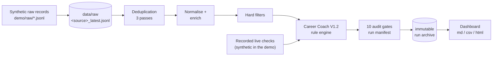

# DS Job Radar

**An explainable, auditable data pipeline and rule engine that turns noisy Data Science job postings from Malaysia
and Singapore into evidence-backed application decisions.**

> **Live source-specific collection adapters are excluded from this public release. The processing and decision
> pipeline can be demonstrated offline using synthetic input data.**

DS Job Radar takes raw job postings, normalises and deduplicates them, and classifies each role by the work its
description actually describes. A rule engine (Career Coach V1.2) then decides how much effort each job deserves and
what to do next. Every decision names the rule that made it and the evidence behind it. Every run is checked by 10
audit gates; a run that fails the audit is not archived, and every other run is archived immutably.

> This is a **data engineering and decision-logic project**, not a machine-learning project. No model is trained.
> Classification and decisions are deterministic rules applied to job-description text.

---

## 1. What the project does

| | |
|---|---|
| **Input** | Raw job-posting records (`data/raw/<source>_latest.jsonl`). In this public release they come from the synthetic demo dataset in `demo/`. |
| **Processing** | Normalisation, three-pass deduplication, text-evidence enrichment, hard filters, rule-based decisions |
| **Output** | One explained decision per job (priority and next action), a dashboard (Markdown, CSV, HTML), a run manifest and, for runs that do not fail the audit, an immutable run archive |
| **Stack** | Python 3.12, pydantic, pandas, rapidfuzz, PyYAML, pytest |
| **Scope** | Personal job-search decision support; it recommends, and never applies to jobs or contacts anyone |

## 2. Problem statement

Searching for Data Science roles across job boards produces noisy, repetitive and hard-to-compare data:

- **Duplicates.** Overlapping keyword searches return the same posting many times, and recruitment agencies repost
  the same job under their own names.
- **Misleading titles.** A posting titled "Data Scientist" can be mostly dashboards and reporting, while a
  "Machine Learning" search returns unrelated software roles.
- **Inconsistent fields.** Salary, location and dates arrive in different shapes per source, and some are missing.
- **Buried constraints.** Salary ranges, explicit nationality restrictions and how to apply sit in free text.

The question the system answers is: *of today's postings, which deserve my time, what should I do next for each,
and why?*

## 3. My role and contribution

The project requirements, architecture, data rules and key design decisions were defined by me. Implementation was
carried out with **Claude Code** (an AI coding assistant), which wrote the code and tests to my specifications.

I worked in gated steps:

1. a read-only design or audit;
2. my approval of a specific plan;
3. implementation;
4. my review, often in several independent read-only review rounds;
5. a separate approval before each commit.

Decisions I made include:

- **Source vetting.** Check each candidate source's robots.txt and bot protection before choosing it. This is why
  JobStreet, Indeed, LinkedIn and Glints were excluded.
- **Classification by content.** Classify roles by what the description says the job does, not by its title.
- **Evidence rules for filtering.** Never reject on uncertainty, only on explicit evidence.
- **Rules instead of a score.** Replace the weighted scoring model with explicit, explainable rules (see
  section 8).
- **Human review of live evidence.** Design the live-evidence workflow so that a person reviews observations before
  they are recorded.
- **Reliability work.** Commission bounded retries after a real production failure, then audit gates, immutable run
  archives and a single-writer lock.

## 4. Architecture of the public version



`scripts/run_demo.py` places the synthetic raw files and then runs the daily run, `scripts/run_all.py --skip-scrape`.
Its stages run in order, and each one stops the run with its own exit code when it fails:

| # | Stage | In this release | Exit code on failure |
|---|---|---|---|
| 1 | scrape | **Skipped.** The collector is not included; the run evaluates raw files already on disk | 10 |
| 2 | pipeline: load, deduplicate, enrich, hard filters | Runs | 20 |
| 3 | coach: Career Coach V1.2 decisions | Runs | 30 |
| 4 | audit: 10 gates and the run manifest (a FAIL verdict stops here) | Runs | 35 |
| 5 | archive: immutable, content-addressed | Runs | 40 |
| 6 | dashboard | Runs | 50 |

The whole run holds a single-writer pipeline lock, so a second writer is refused before it touches anything.

| Layer | Location |
|---|---|
| Generic source-adapter interface (no live implementation) | `src/scrapers/base.py` (`JobSource`) |
| Raw and processed records (pydantic) | `src/models/` |
| Normalisation and parsing | `src/normalizers/`, `src/parsers/` |
| Deduplication | `src/dedup/deduplicator.py` |
| Enrichment (role type, requirements, agency detection, work-authorisation wording) | `src/enrichment/` |
| Hard filters | `src/pipeline/hard_filters.py` |
| Career Coach rule engine, dashboard, audit, archive, lock, logs | `src/career_coach/` |
| Rules and vocabulary (no business logic hard-coded) | `config/*.yaml` |
| Offline demo | `scripts/run_demo.py`, `demo/` |
| Earlier weighted-scoring design (kept for reference, not used by the daily run) | `src/scoring/`, `src/transition/`, `src/strategy/`, `src/reporting/` |

## 5. Processing and decision workflow

1. **Load** the raw records of each source and validate each line as a typed `RawJob`.
2. **Deduplicate** in three passes, keeping every source, URL, source id and search query as provenance.
3. **Normalise and enrich:**
   - salary, location and dates;
   - skills and requirements, with years of experience tied to their source sentence;
   - role type from the work the description lists;
   - signals that the poster is a staffing agency;
   - explicit work-authorisation restrictions.
4. **Apply the hard filters.** Rejected jobs stay in the output, with every reason.
5. **Decide each job** with Career Coach V1.2: viability, career value, readiness, priority and next action.
6. **Audit, archive and render** the dashboard.

Data cleaning and normalisation:

- **Salary.**
  - Each source's format is parsed to min, max, currency and period.
  - The currency comes from the source, never guessed from text.
  - An undisclosed salary stays unknown.
- **Location.** Country, city and remote type are taken from each source's location shape.
- **Dates.** Posting age is computed against an explicit as-of date, so historical replays are reproducible.
- **Company and title.** Both are normalised for matching. Descriptions are cleaned of HTML.
- **Typed records.**
  - All records are pydantic models.
  - The decision models reject unknown fields, so schema drift fails loudly.
  - A test pins the decision schema.

## 6. Deduplication approach

The deduplication runs in three passes (`src/dedup/deduplicator.py`):

1. **Within a source.** The same posting returned by several queries shares one source id. Queries are merged and
   the most complete record is kept.
2. **Across sources.** An exact match on normalised company, title and location.
3. **Recruiter reposts.** Within the same normalised title and country, two postings whose description and
   requirements text reach a `rapidfuzz` `fuzz.ratio` of 90 or more are merged.
   - This is a character-level string-similarity comparison, not a semantic or learned model.
   - The threshold of 90 was chosen from a small set of observed pairs:
     - known reposts scored about 99 to 100;
     - similar but different jobs scored about 80 and below.

No provenance is discarded. A repost found under another company name becomes one of three signals that a poster is
a staffing agency.

## 7. Rule-based classification

- **Role type.** Each posting gets a role type such as `TRUE_DS`, `DS_TITLE_BUT_ANALYTICS_HEAVY`, `ANALYST_NOT_DS`
  or `SOFTWARE_ENGINEER`, from description evidence.
- **Work activities.** The Career Coach recognises activities (modelling, experimentation, deployment, analytics,
  dashboards and others) only when a verb and its object appear in the **same responsibility sentence**.
- **Requirement text never counts as work.**
- **Configuration and regression tests.** The patterns live in `config/career_coach.yaml`. Each false positive found
  by replaying real postings was fixed with its own regression test. For example, "delivery" is not a verb and
  "large-scale" is not "scale".
- **Hard filters reject only on explicit evidence.**
  - HC-1 removes roles with no Data Science component.
  - HC-2 removes postings that explicitly exclude foreign applicants.
  - Other hard filters cover role family, description length, posting age (more than 120 days) and geography.
  - Sponsorship wording, "Senior" in a title or a missing preferred skill are never reasons to reject.

## 8. Career Coach V1.2

A deterministic rule engine (`src/career_coach/rules.py`):

1. **Viability:** blocked, unknown or viable.
2. **Career value** against the declared target tracks.
3. **Readiness:** experience, seniority and education.
4. **Priority:** HIGH, PRIORITY, SELECTIVE, VERIFY_FIRST or DO_NOT_INVEST, from an ordered list of 12 rules.
5. **Next action:** for example APPLY, TAILOR_RESUME, RESEARCH_EMPLOYER, VERIFY_APPLICATION_CHANNEL or
   DO_NOT_INVEST.

Every field records its rule id. Candidate facts (target tracks, salary floor, work authorisation, years of
experience) are **declared** in `config/profile.yaml`, never inferred. The profile in this repository is a fictional
example.

**Application-channel check (Singapore).**

- **The rule.** For MyCareersFuture postings, a job description without an email address is blocked.
- **No live evidence.** A stored description with an email address but no current live check becomes "verify
  first".
- **Live evidence.** It is used only when it is dated on or before the run date and at most 7 days old.
- **Recording.** Live checks are appended through `scripts/record_live_checks.py` from reviewed observations. The
  producer that observed postings on the website is excluded from this release.

### Design decision: why explicit rules replaced the weighted score

The first versions ranked jobs with a weighted score:

- `0.60 × Base + 0.40 × Personal Transition Fit`, plus bonuses and penalties;
- tier cut-offs on top;
- an "interview fit" heuristic.

The weights and the interview-fit heuristic could not be calibrated, because no application-outcome data existed.
The project's own documentation describes interview fit as "not a probability" for that reason. A precise-looking
number would have suggested more confidence than the evidence supported.

In September 2026 I redesigned the decision layer as an independent rule engine, built to the principle "no scores,
no weights, no probabilities". The work had five gates:

1. Freeze the schema.
2. Replay historical data through the new engine.
3. Run it operationally, with a dashboard.
4. Add application logging.
5. Add run archiving.

Each gate was approved separately. The result trades numeric nuance for decisions that can be read, checked and
challenged line by line. Calibrating priorities from recorded outcomes remains a planned, **not implemented**,
later step. The earlier scoring code is kept for reference and is not used by the daily run.

## 9. Auditability and data integrity

Every run is graded by **10 audit gates** (`src/career_coach/run_audit.py`):

1. raw-file integrity;
2. interrupted publication;
3. scrape-report hashes;
4. failed queries;
5. a sudden posting-count drop (more than 30%);
6. decision integrity;
7. uncommitted code;
8. missing live evidence;
9. agency markers;
10. uncited experience requirements.

The verdict decides what happens next:

- **FAIL** stops the run before it is archived. Its manifest is still written, so the failure can be inspected.
- **INVESTIGATE** completes and archives the run, but reports it as not cleared.
- **PASS** completes and archives the run, and is the only verdict that reports success.

Other safeguards:

- **Run manifest** (`run_manifest.json`). It records:
  - the SHA-256 of each raw input file and of the scrape report;
  - the number of live-check records;
  - the SHA-256 of the run outputs (`decisions.json`, `run_meta.json`);
  - the code commit;
  - every gate result.
- **Immutable archives.**
  - Each run that does not fail the audit is archived under an id derived from its inputs and code.
  - An archive is never overwritten.
  - Re-running identical inputs only verifies the existing archive.
- **Pipeline lock.** A single-writer lock prevents two processes from writing the data folder at once.
- **Append-only records.** Live checks and the manual application log can only be added to. A mistake is corrected
  by a new "void" event, never by editing.

## 10. Technologies used

- **Python 3.12.**
- **Data handling:** pydantic v2 (typed, validated records), pandas and pyarrow (the legacy outputs).
- **Text processing:** rapidfuzz (string similarity), python-dateutil, regular expressions, and beautifulsoup4 for
  stripping HTML from descriptions.
- **Configuration:** PyYAML.
- **Testing:** pytest.
- **Storage:** JSON Lines and JSON files. There is no database.

## 11. Installation and offline demonstration

Clone the repository with `git clone`, using the URL GitHub shows after the repository is created. Then:

```bash
cd DS-Job-Radar
python3 -m venv .venv
source .venv/bin/activate
pip install -r requirements.txt
python scripts/run_demo.py
```

`run_demo.py` copies the synthetic raw files from `demo/raw/` into `data/raw/`. It then runs:

```bash
python scripts/run_all.py --skip-scrape --as-of 2026-01-15 --live-checks demo/live_checks.jsonl
```

No network request is made. Outputs are written under `data/` (gitignored):

- the decisions, the manifest and the dashboard in `data/output/career_coach_operational/`;
- the run archive in `data/archive/runs/`.

**What the demo produces:**
- **Funnel:** 14 synthetic records become 12 jobs; 9 pass the hard filters and 3 are rejected.
- **Priorities:** HIGH 2, PRIORITY 1, SELECTIVE 1, VERIFY_FIRST 3, DO_NOT_INVEST 5.
- **Audit verdict: INVESTIGATE.** The synthetic data has no scrape report. Its `example.test` URLs carry no real
  posting IDs, so the audit cannot confirm the live evidence as current.

Every job's decision is in [demo/README.md](demo/README.md). Operating details are in
[docs/OPERATIONS.md](docs/OPERATIONS.md): the live-check recorder, the application log and the learning report.

Running `python scripts/run_all.py` **without** `--skip-scrape` fails at the scrape stage (exit 10), because the
collector is not included.

## 12. Running the tests

```bash
python -m pytest -q
```

- **Result** (pytest, 2026-11-18): **1,048 passed, 10 skipped, 0 failed**.
- **Offline:** the suite makes no network requests.
- **Clone, don't download a ZIP:** two tests ask git whether runtime files are ignored, so run the suite from a git
  clone.
- **Why 10 tests skip:** they need private production data that is deliberately not published. Each skips with its
  reason:
  - 5 dashboard tests need the real 2026-09 run archives;
  - 3 tests need real raw snapshots;
  - 1 test needs a real run archive;
  - 1 test needs the real live-check history.
- **What the tests cover:**
  - parsing and normalisation;
  - deduplication;
  - classification and hard filters;
  - the Career Coach rules, with regression cases;
  - dashboard placement;
  - audit gates, archives and the lock;
  - the append-only logs.
- **Left out of this public release:**
  - tests of the excluded collectors, retry helper and live-check producer;
  - tests that pin results on real job postings, which are private.
- **Coverage:** code coverage has not been measured.

## 13. What is excluded, and why

| Excluded | Why |
|---|---|
| The MyCareersFuture and Hiredly collection adapters, their retry helper, the scraper command and its raw-file publication, the live-check producer, and a source smoke test | Source-specific live collection is kept out of the public release. The current Terms of Use of these sources have not been reviewed. |
| Search queries, endpoints and request settings | Same reason. `config/sources.yaml` keeps only the source names. |
| Real raw postings, run archives, live-check history and the application log | Private data. The demo uses synthetic data only. |
| Tests that need the above | They cannot run without the excluded code or private data. |

Still present: the `JobSource` interface and each source's field parsing in the normalisers. Raw files in the
`RawJob` format (`src/models/raw_job.py`) can be placed in `data/raw/` and processed by the same pipeline.

## 14. Limitations and possible future improvements

**Limitations**

- **No live collection.** This release processes raw files already on disk. It has not been run against the live
  sources in this form.
- **The demo is never "cleared".** Its audit verdict is INVESTIGATE, because synthetic data has no scrape report and
  no real posting IDs.
- **Singapore only for the channel rule.** The application-channel rule applies only to MyCareersFuture postings.
- **Hand-maintained rules.** Classification is rule-based (regular expressions in YAML) and needs maintenance. The
  agency name list will miss unlisted agencies.
- **A small calibration set.** The deduplication threshold was calibrated on a few observed pairs.
- **No scheduler.** Runs are started by hand.
- **Legacy code.** The earlier weighted-scoring code remains in the repository.
- **No machine learning.** Decisions are rule-based by design.

**Possible future work (not implemented)**

- Calibrating priorities from recorded application outcomes, once enough exist.
- Coverage measurement and continuous integration.
- Retiring the legacy scoring layers.

## Licence

No licence has been chosen yet.
